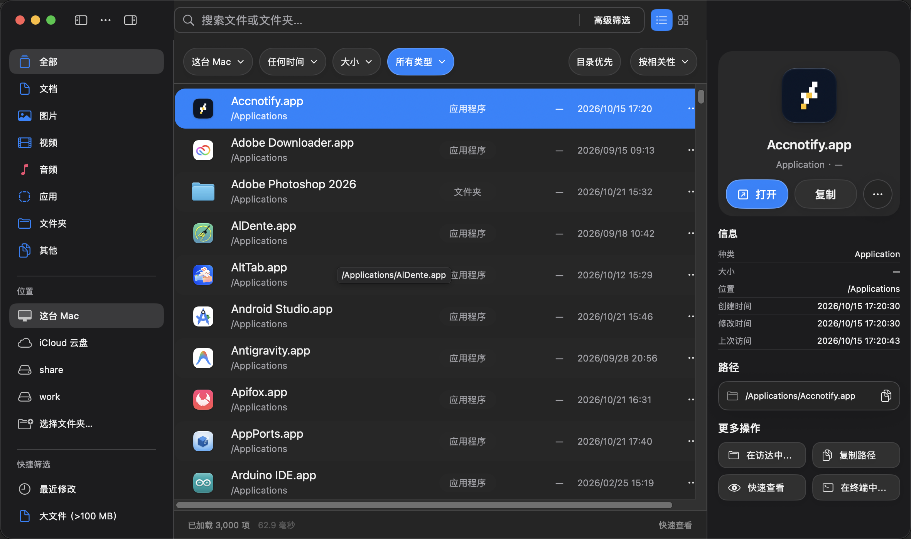

# FSearch for macOS

[简体中文](README.md) | [English](README.en.md)

A macOS file search app based on [noahdunnagan/fsearch](https://github.com/noahdunnagan/fsearch). Find files and folders in a familiar Finder-style interface, narrow results by type, size, modification time, or location, then preview, open, copy, or drag files directly from the results.

The interface is available in English and Simplified Chinese, with automatic system language detection. Choose a language in Settings → Appearance → Language.

## Screenshots

### Light mode


### Dark mode



## Features

- **Instant search**: Search as you type, with fuzzy matching and typo tolerance. Leave the search field empty to browse indexed files.
- **Categories and locations**: Browse documents, images, videos, audio, applications, and folders in the sidebar. Search this Mac, a specific folder, or indexed mounted drives.
- **Advanced filters**: Use the button at the end of the search field to combine filename matching, file type, custom extensions, size ranges, modification time, and search location. Changes take effect when you click Apply.
- **Result browsing**: Switch between list and grid views. Sort by relevance, name, size, or modification time, with an optional folders-first setting. Filtering and sorting apply to all matching results.
- **File actions**: Double-click to open a file or press Space for Quick Look. Copy selected files for pasting into other apps, or drag them directly into another app. The details panel also provides file information, path copying, Reveal in Finder, and opening the containing folder in Terminal.
- **Drive indexing**: Automatically track file changes on internal storage. Authorize and update external and network drives individually, and exclude folders you do not want to search.
- **Appearance and shortcuts**: Follow the system appearance or choose light or dark mode, select an accent color, adjust row spacing, set a global search shortcut, and launch at login.
- **English and Chinese**: Detect the system language automatically or select English or Simplified Chinese in Settings → Appearance → Language.
- **In-app updates**: Check for new versions in About, with automatic checks and background downloads. Install and restart to use the new version.

Use the toolbar buttons to open or close either sidebar. The window widens when needed to display an opened sidebar.

## Installation and first launch

Requires **macOS 13 or later**. Release packages support both Apple Silicon and Intel Macs.

Download a DMG from [GitHub Releases](https://github.com/trah01/fsearch-gui/releases), open it, and drag FSearch into Applications. After installation, check for updates in Settings → About (设置 → 关于) or choose Check for Updates (检查更新…) from the app menu.

### Building from source

Requires Rust and Xcode Command Line Tools. The version comes from the root [VERSION](VERSION) file.

Run these commands from this project's directory:

```sh
bash scripts/build-app.sh
open build/FSearch.app
```

The app is created at `build/FSearch.app`. You can copy it to your Applications folder before using it.

### First launch

1. **Wait for the initial index**: FSearch needs to build an index on first launch. If the index is not ready, wait a moment and click Retry (重试).
2. **Check access permissions**: Open Settings → Index (设置 → 索引). To search protected folders on internal storage, add and enable FSearch in System Settings → Privacy & Security → Full Disk Access, then return to the app and click Reload Permissions (重新载入权限).
3. **Add other drives**: Select an external or network drive, click Allow Access (允许访问), choose the drive's root folder, and click Update Index (更新索引). Disconnected drives are excluded from results; reconnecting a drive makes its existing index available again.

## Search and filtering

Type a filename to begin. The controls below the toolbar provide quick access to location, modification time, size, file type, and sorting. For more precise combinations, use Advanced Filters (高级筛选) at the right end of the search field.

Choose Custom Extensions (自定义后缀) and enter `pdf, docx, xlsx` to include several formats. Leading dots, such as `.pdf`, are also accepted. Select a search folder or enter its full path; `~` refers to your home folder.

You can also enter search syntax directly:

| Example | Action |
| --- | --- |
| `report 2026` | Combine multiple search terms |
| `report !draft` | Search for report while excluding draft |
| `'report` | Match report literally, without fuzzy matching for that term |
| `^report` | Match filenames starting with report |
| `.pdf$` | Match filenames ending in .pdf |
| `ext:pdf,docx` | Filter by file extension |
| `size:>100MB` | Find files larger than 100 MB |
| `mtime:<7d` | Find files modified within the last 7 days |
| `report in:~/Documents` | Search for report inside your Documents folder |

The graphical interface focuses on filename search. The upstream project also provides a command-line tool, file content search, and MCP support. See the [upstream documentation](https://github.com/noahdunnagan/fsearch#readme) for those features.

## Keyboard shortcuts

| Shortcut | Action |
| --- | --- |
| `⌘F` | Focus the search field |
| `⌘O` | Choose a search folder |
| `⌘,` | Open Settings |
| `⌘C` | Copy the selected file |
| `Space` | Quick Look for the selected file |
| `Return` | Open the selected file |
| `⌃⌘S` | Toggle the left sidebar |
| `⌃⌘I` | Toggle file details |

A global shortcut for bringing up the search window can be selected in Settings → General (设置 → 通用). It is disabled by default.

## Settings

| Page | Options |
| --- | --- |
| General (通用) | Global search shortcut, launch at login, and whether closing the window keeps the app running or quits it |
| Search (搜索) | Default location and sort order, folders first, remembering filters, and result loading mode |
| Index (索引) | Drive permissions and index status, updating indexes, automatic updates for internal storage, and excluded folders |
| Appearance (外观) | Automatic language detection or English/Chinese selection; system, light, or dark appearance; accent color; row spacing; and sidebar visibility |
| About (关于) | Current version, update checks, automatic checks and downloads, and links to this project and upstream |

By default, FSearch displays the first 3,000 results and loads more as you scroll. Loading all results at once can use more than **1 GB of memory** and is not recommended.

Excluding a folder immediately hides its files from search results and skips it during subsequent scans. After removing an exclusion, update the index for the drive containing that folder.

FSearch checks GitHub Releases for updates and downloads and verifies them in the app. Choose “Install and Restart” to use the new version, or download an installer through the link in About.

## Upstream project and acknowledgments

This project is based on **[fsearch](https://github.com/noahdunnagan/fsearch)** by **[Noah Dunnagan](https://github.com/noahdunnagan)**. It adds a macOS graphical interface and related features on top of the upstream search engine and command-line tool. Thank you to the original author and contributors for their open-source work.

This repository is an independently maintained derivative, not an official graphical client published or maintained by the upstream author.

## License

Distributed under the [MIT License](LICENSE), retaining the upstream copyright notice and license terms.
